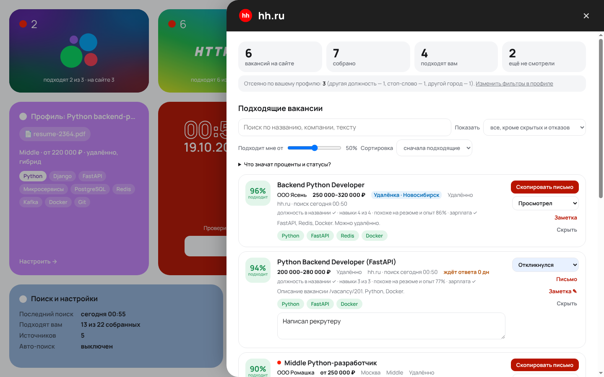
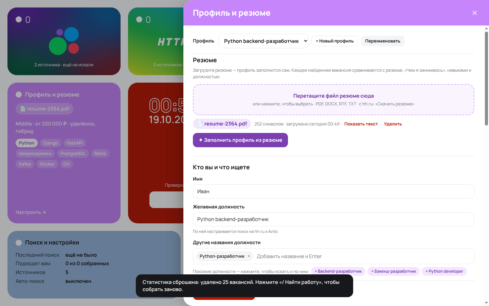

# solk / job

Мини-CRM для поиска работы в РФ в виде расширения для Chrome. Главная страница
собрана из плиток. Нажимаете **«/ Найти работу»**, и расширение обходит hh.ru, Avito,
Telegram-каналы и сайты компаний **в вашем же браузере**: с вашим IP, вашими входами в
аккаунты и с человеческой скоростью. Плитки источников показывают, сколько вакансий
там вам подходит. Откликаетесь вы сами, по ссылке.


## Установка (3 минуты)

1. Скачайте проект: на GitHub нажмите **Code → Download ZIP** и распакуйте архив.
2. Откройте страницу расширений:
   - Chrome: `chrome://extensions`;
   - Яндекс Браузер: `browser://extensions`;
   - Edge: `edge://extensions`.
3. Включите **«Режим разработчика»** (переключатель справа вверху).
4. Нажмите **«Загрузить распакованное расширение»** и выберите папку `extension` из архива.
5. Откроется главная с панелью профиля. Закрепите иконку расширения на панели браузера
   (значок пазла → булавка): по клику на неё главная открывается снова.
6. Если сверху появилась плашка **«Браузер не дал расширению доступ к сайтам»**, нажмите
   **«Разрешить доступ»**. Без этого сайты компаний (например, tbank.ru), hh.ru и Avito не
   читаются. То же самое можно сделать в карточке расширения: **«Доступ к сайтам» → «На
   всех сайтах»**.

## Публичный запуск

Как выложить solk / job для всех: каталоги, автообновления, сайт-переходник, реклама
РСЯ, Telegram-бот, юридический минимум. Всё это — в [docs/LAUNCH.md](docs/LAUNCH.md).
Сайт лежит в `site/`, бот — в `bot/`, сборка релиза — `npm run pack`.

## Поддержка

Кнопка **«/ поддержка»** на главной открывает Telegram: [t.me/max_max3700](https://t.me/max_max3700).

## Как дать доступ другому человеку

У каждого человека своя копия расширения в его браузере, со своими профилем, резюме и
вакансиями. Ваши данные он не увидит.

1. **«Поиск и настройки» → «Поделиться» → «Скачать расширение для друга (.zip)».**
   Отправьте архив в мессенджере, по почте или ссылкой с Яндекс Диска или Google Drive.
2. Если хотите поделиться своими Telegram-каналами и сайтами компаний, нажмите
   **«Скачать мои источники»** и отправьте этот файл тоже.
3. Другой человек распаковывает архив и устанавливает папку `solk-job` по шагам 2–4
   выше. Потом загружает своё резюме. Ваши источники он добавляет через **«Данные» →
   «Восстановить из копии / добавить источники»**.

Установка по одной ссылке, в один клик, возможна только через Chrome Web Store
(разовый взнос разработчика $5 и проверка Google) или каталог дополнений Яндекс
Браузера.

## Первый запуск

1. **Профиль** (фиолетовая плитка) открывается сам. Перетащите туда резюме (PDF, DOCX,
   RTF или TXT; с hh.ru его можно скачать в любом из этих форматов).
   - Профиль **заполнится и сохранится автоматически**: имя, должность, похожие
     должности, «Чем я занимаюсь», навыки, грейд по стажу, зарплата, формат и город.
     Если профиль уже заполнен, нажмите **«✦ Заполнить профиль из резюме»**.
   - Сразу появляются **поиски на hh.ru и Avito** по вашей должности и городу.
   - Если вы меняете должность, она сразу меняется и в ссылках hh.ru и Avito: в
     автоматических и в ваших собственных, где стояла прежняя должность. Остальные
     фильтры ссылки (зарплата, опыт и т. п.) не меняются.
   - Проверьте остальные поля и нажмите **«Сохранить профиль»**.
2. Под желаемой должностью есть **«Похожие должности»**. Например, к «Маркетологу»
   предлагаются «Менеджер по маркетингу», «Интернет-маркетолог», «Digital-маркетолог».
   Нажмите на нужные, и поиск пойдёт и по ним.
3. **Пример подходящей вакансии.** Вставьте ссылку на вакансию, которая вам нравится, и
   расширение найдёт похожие, даже если у них другое название.
4. **Города** вводятся через запятую или Enter. Сокращения тоже понимаются: СПб, Питер,
   Мск, Екб. По первому городу настраивается регион поиска на hh.ru и Avito.
5. **Telegram и любые сайты с вакансиями.** Нажмите на плитку источника и вставьте
   `@канал` или ссылку: сайт компании, rabota.ru, superjob.ru, rabota.sber.ru,
   rabota.x5.ru, tbank.ru… Свой поиск на hh.ru или Avito с фильтрами добавляется так же.
   - **Должность и город подставляются сами.** Если в ссылке есть параметр поиска
     (`?query=`, `?q=`, `searchQuery=`…), должность из профиля сразу ставится в ссылку.
     Если нет, перед поиском расширение находит на странице поля «должность/поиск» и
     «город», вписывает значения, выбирает город из подсказки сайта и нажимает «Найти».
   - У источника видно, что подставлено: «Подставлено в поля сайта: должность
     «Маркетолог», город Санкт-Петербург». Автоматическое заполнение может ошибиться:
     всё зависит от сайта и профессии. Для узких специальностей проверьте эту строку
     или откройте ссылку сами. Подстановку можно выключить у каждого источника.
   - Если поиск сайта по должности ничего не нашёл (у некоторых сайтов строгий поиск),
     расширение проверяет исходный список страницы целиком.
6. Выберите, **сколько новых вакансий проверить за поиск** (10, 100, 1000 или своё
   число), и нажмите **«/ Найти работу»**. Первый поиск всегда запускаете вы:
   автопоиск по расписанию включается только после него.

## Что на главной

| Плитка | Что показывает | По клику |
|---|---|---|
| **Avito, https://, Telegram, hh** | Число вакансий, которые прошли фильтры профиля и подходят вам. Подпись: «подходят 19 из 100 · на сайте 419». Красная точка — есть новые, оранжевая — сайт попросил проверку. | Панель площадки: на сайте / собрано / подходят / ещё не смотрели, список вакансий, источники. |
| **Центр** | Время, дата, «/ поддержка» (Telegram), имя, должность, лимит проверки, кнопка «/ Найти работу» с прогрессом («Ищу: Avito · стр. 3 · 140 вак. · 2/5») и «■ Стоп». Во время поиска вместо лимита — таймер «осталось ≈ 3:12 · готово к 16:15». | Клик по имени открывает профиль. |
| **Профиль и резюме** | Резюме, условия, навыки (основные выделены). | Настройка профиля. |
| **Лучшее для вас** | Самые подходящие вакансии, которые вы ещё не разобрали (столько, сколько помещается). | **Всё в одном месте:** воронка (подходят вам, ещё не смотрел, в «Моих откликах», интервью и офферы), вкладки статусов с числами, все фильтры и список. Число «Подходят вам» везде одинаковое. |
| **Партнёры** | Баннеры партнёров по очереди, с пометкой «Реклама · рекламодатель · erid». Сначала — те, что подходят профессии из профиля. | Переход по партнёрской ссылке. |
| **Поиск и настройки** | Когда искали, сколько подходит, проблемы с источниками. | Настройки, все источники, журнал, выгрузка в Excel. |
| **Мои отклики** | Вакансии со статусом Откликнулся, Отправил резюме, Интервью, Оффер, Отказ (без «Не смотрел», «Просмотрел» и «Скрыто»). Сколько дней ждёте ответа. | Список с вкладками статусов и заметками. |

### Как отбираются вакансии

Вакансия показывается, только если проходит **все фильтры вашего профиля**. Остальные
не видны и не входят в «подходят вам». В панели площадки написано, сколько вакансий
отсеяно и почему: «другая должность — 90, другой город — 25».

- **Должность.** В вакансии должна быть ваша желаемая должность или одно из «Других
  названий» там, где вы отметили в профиле («Искать должность только»): в названии
  вакансии, названии компании, описании. По умолчанию — название и описание.
  - Сравниваются смысловые слова с учётом падежей. «Главный специалист отдела
    безопасности» не пройдёт к «Специалисту по маркетингу»: общие слова
    «специалист», «менеджер», «руководитель» сами по себе не считаются.
  - Английские названия переводятся: Marketing manager = менеджер по маркетингу,
    Product Marketing Manager (PMM) = продуктовый маркетолог или PMM.
  - В описании должность должна быть в начале текста или встречаться хотя бы дважды.
  - Вакансии с должностью в названии всегда выше остальных.
- **Город.** Только города из профиля. Вакансия из другого города показывается, лишь
  если работа удалённая (и в «Формате» отмечено «Удалённо»). У такой вакансии видна
  синяя пометка «Удалёнка · Новосибирск».
- **Тип занятости, формат, стоп-слова, свежесть** — как отмечено в профиле.

Фильтры одинаково работают для автопоиска, ваших ссылок на hh.ru или Avito без
фильтров, Telegram и сайтов компаний. Настраивать фильтры на самих сайтах не нужно.

### Несколько профилей

В панели профиля вверху есть переключатель: «+ Новый профиль», «Переименовать»,
«Удалить». Так можно искать, например, «Маркетолога» и «Продакт-маркетолога» отдельно.
- У каждого профиля своё резюме, должность, фильтры и статусы откликов.
- Источники и собранные вакансии общие: новый профиль сразу отбирает из уже собранного
  по своим правилам.
- Новый профиль начинается с пустыми данными.
- Переключение, создание и удаление профиля поиск не запускают. Следующий автопоиск у
  каждого источника — через его интервал.
- Удаление профиля — только после двух подтверждений.

### Стоп и сброс

- **«■ Стоп»** рядом с «/ Найти работу» останавливает поиск мгновенно, даже если сайт
  ещё грузится или идёт пауза между источниками. Главная сразу возвращается в
  исходное состояние, вкладка закрывается, найденное сохраняется. Можно сразу
  поправить профиль и искать снова: оценки пересчитываются мгновенно.
- **Таймер.** При запуске всплывает «займёт около 4 минут», а во время поиска вместо
  лимита виден обратный отсчёт: «осталось ≈ 3:12 · готово к 16:15». Время считается по
  числу страниц и описаний в каждом источнике. Если источник уже обходили, учитывается,
  сколько это заняло в прошлый раз, поэтому с каждым поиском оценка точнее.
- После «Стоп» расписание сбрасывается у всех источников. Автопоиск снова зайдёт в
  источник только через его интервал: через 10 минут, через 3 часа и т. д., а не на
  следующем пятиминутном шаге.
- Новый источник сам не запускается: первый раз — кнопкой «Искать» или «/ Найти
  работу», дальше по его интервалу.
- **«Поиск и настройки» → «Данные» → «Сбросить статистику»** удаляет собранные
  вакансии, статусы и журнал. Срабатывает после двух подтверждений. Источники, профили,
  резюме и настройки остаются.

### Что значит «Подходит мне 72%»

Это совпадение вакансии с вашим профилем. Под каждой вакансией написано, из чего оно
сложилось, например: «должность ✓ · навыки 4 из 5 · похоже на резюме и опыт 80% ·
зарплата ✓». Учитываются:
- желаемая должность и её синонимы;
- навыки;
- текст резюме, «Чем я занимаюсь» и примеры вакансий;
- зарплата, грейд и свежесть.

Ползунок «Подходит мне от …%» скрывает вакансии ниже порога.

**Статусы ставите вы сами:**
- «Откликнулся» — откликнулись на сайте (ставите сами: кнопкой «Я откликнулся» в окне
  письма или в списке статусов);
- «Отправил резюме» — отправили резюме;
- «Отказ» — работодатель отказал;
- «Скрыто» — вакансия неинтересна.

Система статусы не угадывает. Всё, кроме «Не смотрел», «Просмотрел» и «Скрыто», попадает в
«Мои отклики» и хранится всегда, даже если вакансию сняли с сайта.

**Время у вакансии:**
- «hh.ru · поиск сегодня 18:12» — когда её последний раз видел поиск solk / job,
  то же время, что «Последний поиск»;
- «опубл. 14 окт.» — дата публикации на сайте.

### Сопроводительное письмо под каждую вакансию

solk / job не откликается за вас и сам ничего не нажимает на сайтах: на hh.ru, Avito, в
Telegram и на сайтах компаний откликаетесь вы. Расширение готовит письмо и подсказывает,
куда его вставить.

1. У вакансии нажмите **«Скопировать письмо»**. Письмо под эту вакансию сразу окажется
   в буфере обмена. Откроется окно с текстом, его можно поправить.
2. **«Открыть вакансию»** — она откроется в новой вкладке.
3. На сайте нажмите «Откликнуться» и щёлкните в поле сопроводительного письма. Вставьте:
   **Ctrl + V** на Windows или **⌘ Cmd + V** на Mac.
4. Отправьте отклик и вернитесь. Нажмите **«Я откликнулся»** в окне письма или выберите
   статус «Откликнулся» у вакансии. Статус ставите только вы.

**Шаблон «Под вакансию»** включён по умолчанию, письмо собирается само из:
- названия вакансии и компании;
- навыков, которые совпали с описанием, и остальных основных навыков;
- вашей должности и грейда;
- одного-двух предложений из «Чем я занимаюсь», самых близких к тексту вакансии;
- формата работы и города, если они совпадают;
- подписи: имя и контакты.

**Свои шаблоны** — в «Поиск и настройки» → «Сопроводительные письма» → «+ Шаблон». Там же
пошаговая инструкция, контакты для подписи и «Пишу от лица»: «рад / готов» или «рада /
готова».
- Подстановки: {вакансия} {компания} {имя} {должность} {навыки} {опыт} {контакты}.
  {навыки} — до 5, сначала совпавшие с вакансией; {опыт} — первое предложение «Чем я
  занимаюсь».
- Фрагмент в [[двойных скобках]] пропадает, если в нём пустая подстановка.

### Напоминания о следующем шаге

Приходят в браузере и в Telegram, каждое — один раз:
- «7 дней без ответа — напишите рекрутеру», через 14 дней — ещё одно;
- «Интервью завтра в 14:00 — подготовьтесь», за 3 часа («через 2 ч 15 мин», «через
  5 мин») и после интервью. Дату интервью укажите у вакансии со статусом «Интервью»:
  выберите в календаре или впишите с клавиатуры (день, месяц, год, время), затем Enter;
- «Оффер ждёт ответа» — через 2 дня.

Все текущие напоминания видны вверху «Моих откликов». Если напоминать нечего, этого блока нет. Выключить: «Поиск и настройки» →
«Напоминать о следующем шаге».

### Резервная копия на Яндекс Диске

«Поиск и настройки» → «Резервная копия на Яндекс Диске» → «Подключить».
- Доступ выдаётся только к папке «Приложения/solk-job».
- Копия сохраняется сама после каждого поиска, не чаще раза в 12 часов, и по кнопке
  «Сохранить сейчас».
- На новом компьютере: установить расширение → подключить Диск → данные вернутся
  сами. Если на этом компьютере уже есть данные, — кнопкой «Восстановить из облака».

### Данные не пропадают

Всё хранится в браузере (chrome.storage, без ограничения объёма) и переживает
перезапуск браузера и выключение компьютера: профили, резюме, найденные и просмотренные
вакансии, статусы, заметки, настройки. Это проверяет сквозной тест: браузер
закрывается и открывается заново. Автоудаление выключено. Включить его можно в
«Поиск и настройки» → «Удалять нетронутые через N дней». Данные исчезают, только
если удалить расширение или нажать «Сбросить статистику». Перед переустановкой
сделайте «Резервную копию».

### Почему собрано меньше, чем «на сайте»

**Лимит — на весь поиск, а не на каждый источник.** 100 проверок на 3 источника — это
примерно по 34 новых вакансии в каждом. Если в источнике новых меньше, остаток
достаётся следующим. Меньше одной страницы выдачи (~20 вакансий) на источник не
бывает: если источников очень много (например, 200 ссылок при лимите 100), каждый всё
равно проверяется по первой странице. Расширение предупреждает об этом у лимита и при
запуске: так дольше, зато ничего не пропущено.

**Повторный поиск проверяет только новое.** Уже известные вакансии лимит не тратят.
Как только страница выдачи целиком состоит из известных, источник дальше не листается.
Поэтому второй и следующие поиски идут быстро и почти не нагружают сайты.

Например, Avito показывает 419 вакансий, а доля источника 100 — значит, проверены 100
самых свежих. Полное описание расширение открывает только у 30 лучших новых вакансий
из источника (у Avito — у 10, у сайтов компаний — у 20). Остальные оцениваются по
карточке из выдачи. Так поиск занимает минуты, а не часы.

### Сайты, которые «не сканируются»

- Сайты, где вакансии рисует скрипт, а в ссылках нет слов vacancy/job (например,
  `/search/4219605`), распознаются по одинаковым ссылкам с номерами в списке.
- Если на странице нет карточек, но есть данные для скрипта (Next.js, Nuxt и т. п.),
  вакансии берутся оттуда.
- **Сайты банков в Яндекс Браузере** (tbank.ru, rabota.sber.ru) открываются в
  «Защищённом режиме», и расширения туда не пускают (ошибка «Cannot access contents of
  url…»). Расширение пробует обойтись без вкладки:
  - **T-Банк:** вакансии берутся прямо из API, из которого их загружает сам сайт
    (`/pfpjobs/papi/getVacancies`). Это весь список, а отбор по должности и городу
    делает профиль. Формат запроса T-Банк не публикует, поэтому расширение пробует
    несколько вариантов и запоминает рабочий.
  - Остальные такие сайты расширение скачивает и разбирает само. Поля на сайте в этом
    режиме не заполняются, должность подставляется только в ссылку.
  - Если и так не вышло, у источника появится ошибка про «Защищённый режим». Выключите
    его: **☰ → Настройки → Безопасность → «Защита от угроз»** → снимите галочку
    **«Открывать страницы онлайн-банков и платёжных систем в защищённом режиме»**, затем
    нажмите «Искать». Строки «Access to fetch at https://www.tbank.ru/… has been blocked
    by CORS policy» в «Ошибках» расширения — та же причина, а не поломка: браузер не
    пускает расширение к сайту банка даже запросом. Расширение делает одну попытку за
    поиск и сразу показывает справку.

**Что делать, если сайт не сканируется.** У источника с проблемой появляется «…что
делать?» с шагами именно для этой проблемы. Все случаи собраны в «Поиск и настройки» →
«Сайт не сканируется — что делать»:
- защищённый режим банка — как выключить (выше);
- нет доступа к сайту — «Разрешить доступ» или «Доступ к сайтам» → «На всех сайтах»;
- сайт попросил проверку (капча) — пройти её на сайте, источник отдыхает 6 часов;
- страница не открылась — проверить ссылку, вход на сайт, VPN;
- вакансий не нашлось:
  - ссылка не на список вакансий;
  - сайт не понял подставленную должность — снять галочку «Подставлять должность и город»;
  - ручная настройка: шаблон ссылки или CSS-селектор;
  - «Собрать вакансии с этой вкладки» в меню расширения.

### Актуальность

Снятые с публикации и ушедшие в архив вакансии исчезают из списков сами. Если вы уже
откликнулись на такую вакансию, она остаётся в «Моих откликах»:
- **hh.ru и Avito.** Расширение перепроверяет давно не встречавшиеся вакансии из
  вашего списка.
- **Сайты компаний.** Вакансия считается снятой, если её нет на странице два поиска подряд.

Вакансии старше 30 дней не показываются (срок меняется в профиле).





## Как это устроено

Это та же идея, что открыть вкладку, зайти в «Исследовать элемент» и выполнить скрипт в
консоли, только автоматически:

1. Расширение открывает страницу поиска в фоновой вкладке.
2. Внедряет туда скрипт [`extension/extractors/page.js`](extension/extractors/page.js),
   который читает карточки вакансий.
3. Для новых вакансий по одной, с паузами, подгружает полное описание.
4. Закрывает вкладку.

Из текста извлекаются зарплата, грейд, формат, навыки и дата. Дубли склеиваются:
пост в Telegram со ссылкой на вакансию hh — это та же вакансия.

Все данные, включая резюме, хранятся **только в вашем браузере** и никуда не
отправляются. В «Поиск и настройки» → «Данные» можно сделать резервную копию.

Автопоиск по расписанию работает, пока открыт браузер: hh.ru раз в 2 часа, Avito раз в
4 часа, Telegram раз в час. Интервал каждого источника меняется в его панели.

## Ограничения и правила безопасности

- **Поиск идёт, только пока открыт браузер.** Если Chrome закрыт, сбора нет. Когда
  захочется круглосуточного сбора, переходите к серверной части из
  [docs/ARCHITECTURE.md](docs/ARCHITECTURE.md).
- **«/ Найти работу» не дёргает источник, который проверяли меньше 10 минут назад
  с тем же лимитом.** Если увеличить лимит, поиск запустится сразу.
- **Частота специально низкая:** автопоиск hh раз в 2 часа, Avito раз в 4 часа.
  Между страницами выдачи и карточками стоят паузы в несколько секунд. Не ставьте интервалы короче:
  смысла нет (новых вакансий за 15 минут почти не появляется), а риск ограничений
  растёт.
- **Если сайт показал капчу,** расширение капчу не решает. Оно ставит источник на паузу
  на 6 часов и присылает уведомление. Откройте страницу и пройдите проверку сами.
- **Расширение только читает страницы.** Откликов, сообщений и других действий от
  вашего имени оно не делает. Именно за автоотклики hh.ru закрыл API для соискателей.
- **Вёрстка сайтов меняется.** Экстракторы сначала ищут элементы по атрибутам
  `data-qa` (hh) и `data-marker` (Avito), а если их нет, по шаблону ссылок на вакансии.
  Если источник стал возвращать «пусто», это видно в панели площадки. Тогда
  селекторы нужно поправить в `extension/extractors/page.js`.
- **Правила площадок.** Автоматический сбор формально противоречит пользовательским
  соглашениям hh.ru и Avito. Для личного использования с такой частотой реальный риск
  — временная блокировка IP или капча. Делать на этой основе публичный сервис нельзя.

## Разработка

```
extension/
  manifest.json          MV3-манифест
  background.js          расписание, обход вкладок, сохранение, уведомления
  extractors/page.js     скрипт, который выполняется на странице (hh, Avito, t.me, любой сайт)
  lib/parse.js           разбор зарплаты, грейда, формата, дат, навыков; дедупликация
  lib/match.js           оценка соответствия: навыки + TF-IDF похожесть текста + должность
  lib/skills.js          словарь навыков и синонимов — дополняйте
  lib/store.js           хранилище и настройки по умолчанию
  dashboard.*            главная (плитки) и панели
  ui/                    панели: вакансии, профиль, источники; общие хелперы
  lib/resume.js          чтение резюме: PDF (pdf.js), DOCX, RTF, TXT
  lib/resume-profile.js  «Заполнить из резюме»: имя, должность, навыки, стаж, город…
  lib/roles.js           похожие должности (маркетолог ≈ менеджер по маркетингу)
  lib/geo.js             города: синонимы, регион hh.ru, раздел Avito
  lib/zip.js             ZIP-архив для «Скачать расширение для друга»
  files.json             список файлов для архива (npm run files)
  img/                   логотипы (SVG)
  vendor/pdfjs/          pdf.js 4.10 (Apache-2.0)
  fonts/                 Manrope (SIL OFL)
  popup.*                меню иконки
scripts/gen-files.mjs    генерирует extension/files.json
tests/
  unit/                  тесты разбора, оценки и чтения резюме (node --test)
  e2e/run.mjs            сквозной тест в Chromium на локальных копиях страниц
  fixtures/              HTML, имитирующий hh.ru, Avito, t.me и карьерный сайт
```

```bash
npm test            # модульные тесты, нужен Node 20+
npm run test:e2e    # сквозной тест: Playwright + Chromium (+ xvfb на Linux)
npm run files       # после добавления/удаления файлов в extension/ — обновить список для архива
```

После правок в коде нажмите «Обновить» (↻) у расширения на `chrome://extensions`.

Фикстуры написаны по известной разметке сайтов, но с настоящими hh.ru и Avito
экстракторы в этой среде не проверялись: доступ к ним отсюда закрыт. После первого
реального поиска откройте панель площадки: у каждого источника видно, сколько найдено
и были ли ошибки.

Серверная архитектура для следующего этапа (круглосуточный сбор, PostgreSQL,
эмбеддинги) описана в [docs/ARCHITECTURE.md](docs/ARCHITECTURE.md).
