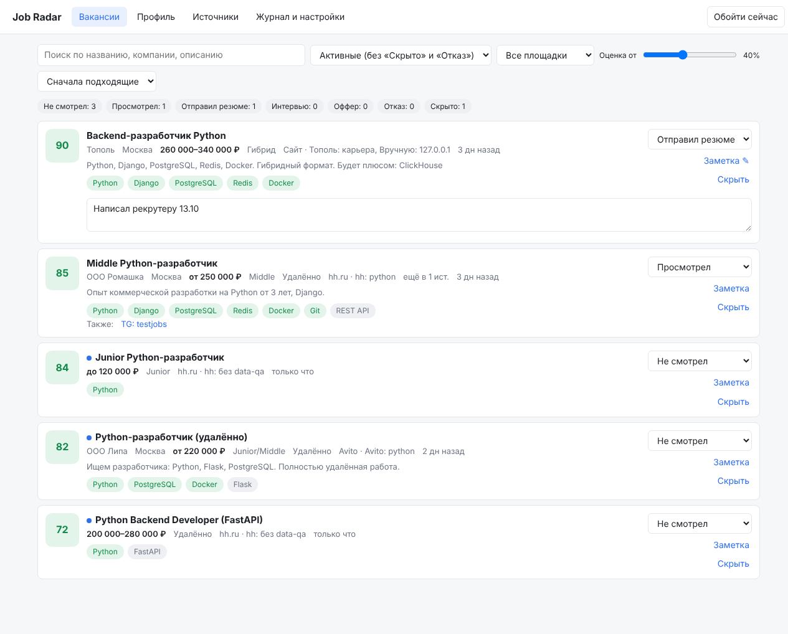
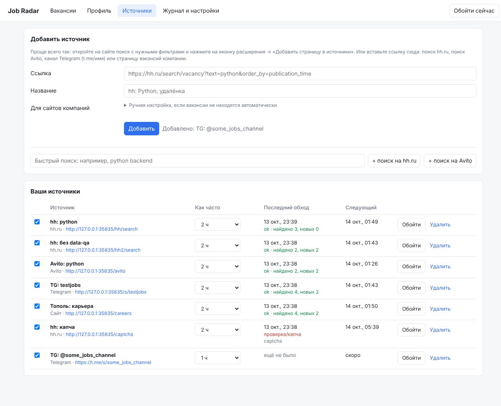

# Job Radar

Мини-CRM для поиска работы в РФ в виде расширения для Chrome. Расширение обходит
ваши сохранённые поиски на hh.ru и Avito, Telegram-каналы и карьерные сайты компаний
**в вашем же браузере**: с вашим IP, вашими cookies и с человеческой скоростью.
Вакансии оно сравнивает с вашим профилем и показывает отсортированными по
соответствию. Откликаетесь вы сами, по ссылке.



## Как это работает

По сути это та же идея, что открыть вкладку, зайти в «Исследовать элемент» и выполнить
скрипт в консоли, только автоматически:

1. Раз в несколько минут фон расширения проверяет, у каких источников подошло время обхода.
2. Нужная страница открывается в фоновой вкладке, туда внедряется скрипт
   [`extension/extractors/page.js`](extension/extractors/page.js), он читает со страницы
   карточки вакансий, и вкладка закрывается.
3. Для новых вакансий скрипт по одной, с паузами в несколько секунд, подгружает
   страницу с полным описанием. Запросы идут с того же сайта и с вашими cookies.
4. Текст разбирается: из него извлекаются зарплата, грейд, формат работы, навыки и
   дата. Дубли склеиваются: например, если пост в Telegram ссылается на вакансию hh,
   это одна вакансия.
5. В CRM каждая вакансия получает оценку от 0 до 100 по навыкам, названию, грейду,
   зарплате и свежести. Видно, какие навыки совпали и каких не хватает.

Все данные хранятся только в вашем браузере (`chrome.storage.local`), на сервер ничего
не отправляется.

## Установка (5 минут)

1. Скачайте репозиторий: `git clone` или Code → Download ZIP, затем распакуйте.
2. Откройте в Chrome адрес `chrome://extensions`. Подойдёт и Яндекс Браузер
   (`browser://extensions`), и Edge.
3. Включите **«Режим разработчика»** (переключатель справа вверху).
4. Нажмите **«Загрузить распакованное расширение»** и выберите папку `extension`.
5. Откроется страница профиля. Заполните её:
   - ключевые слова названия (`python, backend`);
   - грейд;
   - навыки, основной стек отметьте звёздочкой: `*Python, *Django, PostgreSQL, Docker`;
   - зарплата;
   - формат работы;
   - стоп-слова.

   Можно вставить текст резюме: расширение найдёт в нём навыки и предложит добавить
   их в профиль.
6. Закрепите иконку расширения на панели браузера (значок пазла → булавка).

## Как добавить источники

Удобнее всего прямо с сайта:

| Где | Что сделать |
|---|---|
| **hh.ru** | Настройте поиск с фильтрами, отсортируйте по дате и нажмите иконку → **«Добавить страницу в источники»**. Можно быть залогиненным, это не обязательно. |
| **Avito** | То же самое: поиск в разделе «Вакансии», сортировка «По дате» → «Добавить страницу в источники». |
| **Telegram** | Во вкладке «Источники» вставьте `https://t.me/имя_канала`. Расширение читает публичное веб-превью `t.me/s/имя_канала`, вход в Telegram не нужен. |
| **Сайт компании** | Откройте страницу со списком вакансий → «Добавить страницу в источники». Браузер спросит разрешение на доступ к этому сайту, его нужно дать. |

Если на сайте компании вакансии не находятся автоматически, укажите во вкладке
«Источники» → «Ручная настройка» шаблон ссылки на вакансию (например
`/vacancies/(\d+)`) или CSS-селектор карточки. Его можно найти через «Исследовать
элемент».

Ещё есть кнопка **«Собрать вакансии с этой вкладки»**. Она разово собирает
вакансии с любой открытой страницы, ничего не добавляя в расписание.

## Работа с CRM



- **Вакансии**: лента по убыванию оценки. Есть фильтры по статусу, площадке,
  порогу оценки и поиск по тексту.
- **Статусы**: Не смотрел → Просмотрел → Отправил резюме → Интервью → Оффер / Отказ,
  плюс «Скрыто» для неинтересных.
  - Клик по названию открывает вакансию и ставит статус «Просмотрел».
  - Скрытые вакансии больше не показываются.
- **Заметка** у каждой вакансии: кому писали, контакты, дата интервью.
- **Уведомления** приходят о новых вакансиях с высокой оценкой. На иконке расширения
  показано число неразобранных подходящих вакансий.
- **Журнал и настройки**:
  - частота обхода;
  - где открывать страницы (фоновая вкладка или свёрнутое окно);
  - порог уведомлений;
  - выгрузка в CSV (открывается в Excel) и резервная копия в JSON.

## Ограничения и правила безопасности

- **Обход идёт, только пока открыт браузер.** Если Chrome закрыт, сбора нет. Когда
  захочется круглосуточного сбора, переходите к серверной части из
  [docs/ARCHITECTURE.md](docs/ARCHITECTURE.md).
- **Частота специально низкая:** hh раз в 2 часа и до 10 описаний за обход, Avito
  раз в 4 часа и до 3 описаний, паузы между запросами. Не ставьте интервалы короче:
  смысла нет (новых вакансий за 15 минут почти не появляется), а риск ограничений
  растёт.
- **Если сайт показал капчу,** расширение капчу не решает. Оно ставит источник на паузу
  на 6 часов и присылает уведомление. Откройте страницу и пройдите проверку сами.
- **Расширение только читает страницы.** Откликов, сообщений и других действий от
  вашего имени оно не делает. Именно за автоотклики hh.ru закрыл API для соискателей.
- **Вёрстка сайтов меняется.** Экстракторы сначала ищут элементы по атрибутам
  `data-qa` (hh) и `data-marker` (Avito), а если их нет, по шаблону ссылок на вакансии.
  Если источник стал возвращать «пусто», это видно во вкладке «Источники». Тогда
  селекторы нужно поправить в `extension/extractors/page.js`.
- **Правила площадок.** Автоматический сбор формально противоречит пользовательским
  соглашениям hh.ru и Avito. Для личного использования с такой частотой реальный риск
  — временная блокировка IP или капча. Делать на этой основе публичный сервис нельзя.

## Разработка

```
extension/
  manifest.json          MV3-манифест
  background.js          расписание, обход вкладок, сохранение, уведомления
  extractors/page.js     скрипт, который выполняется на странице (hh, Avito, t.me, любой сайт)
  lib/parse.js           разбор зарплаты, грейда, формата, дат, навыков; дедупликация
  lib/match.js           оценка соответствия профилю
  lib/skills.js          словарь навыков и синонимов — дополняйте
  lib/store.js           хранилище и настройки по умолчанию
  dashboard.*            CRM
  popup.*                меню иконки
tests/
  unit/                  тесты разбора и оценки (node --test)
  e2e/run.mjs            сквозной тест в Chromium на локальных копиях страниц
  fixtures/              HTML, имитирующий hh.ru, Avito, t.me и карьерный сайт
```

```bash
npm test            # модульные тесты, нужен Node 20+
npm run test:e2e    # сквозной тест: Playwright + Chromium (+ xvfb на Linux)
```

После правок в коде нажмите «Обновить» (↻) у расширения на `chrome://extensions`.

Фикстуры написаны по известной разметке сайтов, но с настоящими hh.ru и Avito
экстракторы в этой среде не проверялись: доступ к ним отсюда закрыт. Первый реальный
прогон смотрите во вкладке «Источники»: там видно, сколько найдено и есть ли ошибки.

Серверная архитектура для следующего этапа (круглосуточный сбор, PostgreSQL,
эмбеддинги) описана в [docs/ARCHITECTURE.md](docs/ARCHITECTURE.md).
